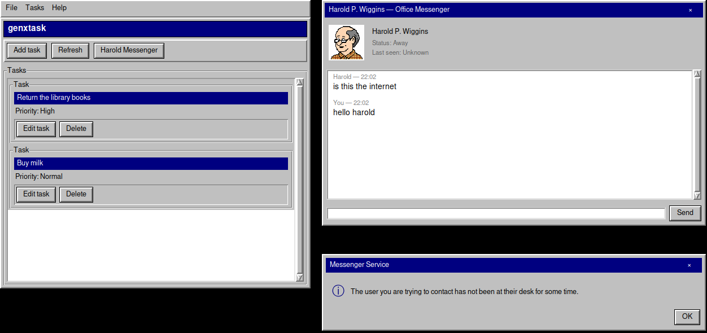

# Gen X Task Manager

App: **genxtask v1.0.0** · [Release and downloads](https://github.com/5nus/Gen-X-Task-Manager/releases/tag/v1.0.0) · [MIT license](LICENSE)

A Linux task manager with a Windows 95 look: create and edit tasks, sort them by
priority, and permanently delete them after confirmation. Includes a calendar,
time selection, independent desktop reminders, and Harold P. Wiggins, an absent
office worker with his own messenger. Harold is not an assistant.



[Download Harold's app icon as a PNG](packaging/genxtask.png).
The project and repository remain **Gen X Task Manager**; the installed
application and its launch command are named **genxtask**.

## Requirements

- Linux, `/usr/bin/python3` version 3.9 or later, Tkinter, and SQLite.
- Reminders additionally require a systemd user manager, a D-Bus session bus,
  `notify-send`, and a desktop notification service such as GNOME, KDE, or Xfce.
- Debian/Ubuntu packages: `python3`, `python3-tk`, and `libnotify-bin` for
  reminders. No additional Python packages are required.
- Tested with Python 3.12, Tk 8.6, and X11. Wayland can be used for notifications;
  window and taskbar icons depend on the desktop and its XWayland/Tk support.

## Install without root privileges

From a repository checkout:

```bash
git clone https://github.com/5nus/Gen-X-Task-Manager.git
cd Gen-X-Task-Manager
/usr/bin/python3 install.py
```

Or from the release archive:

```bash
tar -xzf genxtask-v1.0.0.tar.gz
cd genxtask-v1.0.0
/usr/bin/python3 install.py
```

Then select **genxtask** in your application menu. Alternatively:

```bash
"$HOME/.local/bin/genxtask"
"$HOME/.local/bin/genxtask" --version
```

If `~/.local/bin` is already in your `PATH`, run `genxtask` directly. The desktop
launcher uses an absolute, correctly quoted path. It requires no custom `PATH`,
visible terminal, or manual `PYTHONPATH`. The download or checkout directory can
be removed after installation.

### Installed files and updates

| Contents | Default location |
| --- | --- |
| Python package, assets, uninstaller, installation manifest | `~/.local/share/genx.tasks/` |
| GUI, reminder, and uninstall commands | `~/.local/bin/genxtask`, `genxtask-reminder`, `genxtask-uninstall` |
| Application menu entry | `~/.local/share/applications/genxtask.desktop` |
| Harold icons | `~/.local/share/icons/hicolor/{size}x{size}/apps/genxtask.png` |
| Reminder units | `~/.config/systemd/user/gen-x-task-reminder.{service,timer}` |
| Optional session autostart entry, not yet enabled | `~/.local/share/genx.tasks/integration/gen-x-task-reminder.desktop` |

The installer respects `XDG_DATA_HOME` and `XDG_CONFIG_HOME`. Launch commands
remember the data directory selected during installation so the GUI and reminder
use the same default even outside the download directory. The internal Python
package name `task_manager`, existing database paths, and systemd unit names are
preserved.

The internal program directory remains `genx.tasks` for compatibility with
existing installations. Reinstalling replaces the previous launchers and icons
with the new `genxtask` entries without changing task data.

To update, download the new version and run `install.py` again. Existing databases
and `reminder.env` are preserved. Previously enabled reminder timers are not
stopped; a fresh installation does not enable them automatically. If you change
the XDG installation location, uninstall the previous installation first and
explicitly retain the existing database path.

Harold's unchanged messenger avatar is the only icon source. Its square white
background is retained. All seven icon sizes (16, 24, 32, 48, 64, 128, and 256
pixels) use nearest-neighbor scaling. Tkinter also sets these as the window icon
and the default for additional windows. `StartupWMClass=genxtask` helps associate
the app with its taskbar entry. The desktop controls its final appearance in the
application menu, taskbar, and Alt-Tab view.

## Database path

Existing tasks remain in `$XDG_DATA_HOME/task-manager/tasks.sqlite3` or
`~/.local/share/task-manager/tasks.sqlite3`, separate from the installed program.
No new database migration or automatic deletion of old data is performed.

The GUI and reminder resolve their database path in this order:

1. An explicit `--database` argument.
2. The `TASK_MANAGER_DATABASE` environment variable.
3. The default path in the XDG data directory selected during installation.

```bash
"$HOME/.local/bin/genxtask" --database /absolute/path/tasks.sqlite3
"$HOME/.local/bin/genxtask-reminder" --database /absolute/path/tasks.sqlite3
```

**A custom GUI database path must also be configured for the reminder.**
Independent processes do not inherit each other's command-line arguments. For
example, add this to
`${XDG_CONFIG_HOME:-$HOME/.config}/gen-x-task-manager/reminder.env`:

```ini
TASK_MANAGER_DATABASE="/absolute/path/tasks.sqlite3"
```

Create the directory if needed. This is a systemd environment file, not a shell
script: no `export`, no `$HOME`, and only absolute paths. Existing entries are
preserved during updates. Old `PYTHONPATH` entries are no longer needed after
installation; the installed launch commands load their own package copy.

## Enable and check reminders

Installation provides the units. It does not enable the timer or promise
notifications without a suitable desktop session. The GUI also works with
reminders disabled.

Run these commands in a terminal within your graphical session:

```bash
systemctl --user import-environment DISPLAY WAYLAND_DISPLAY XAUTHORITY
systemctl --user daemon-reload
systemctl --user enable --now gen-x-task-reminder.timer
systemctl --user start gen-x-task-reminder.service
```

Unset variables for the other display type are ignored. At least `DISPLAY` or
`WAYLAND_DISPLAY` must be set in the user manager. The service uses the same
user's D-Bus bus at `unix:path=%t/bus`. Its Python path points to the installed
package copy, not the download directory.

The units are connected to `graphical-session.target`. Check it with:

```bash
systemctl --user is-active graphical-session.target
```

On desktops with an active target, the enabled timer starts with the session.
**For Xfce and other sessions without this target**, also install the supplied
autostart entry:

```bash
mkdir -p "${XDG_CONFIG_HOME:-$HOME/.config}/autostart"
install -m 644 "${XDG_DATA_HOME:-$HOME/.local/share}/genx.tasks/integration/gen-x-task-reminder.desktop" "${XDG_CONFIG_HOME:-$HOME/.config}/autostart/"
```

At the next graphical login, this entry imports the session environment and starts
the same timer. It does not require a repository path. Repeated starts do not
create multiple timer instances. An SSH login is not a graphical session;
`loginctl enable-linger` is not required.

```bash
systemctl --user status gen-x-task-reminder.timer
systemctl --user list-timers --all gen-x-task-reminder.timer
systemctl --user status gen-x-task-reminder.service
journalctl --user -u gen-x-task-reminder.service -n 50 --no-pager
```

The `oneshot` service is normally `inactive (dead)` between successful runs; the
timer should be active. To run one reminder check manually:

```bash
"$HOME/.local/bin/genxtask-reminder"
```

### Troubleshooting

- **Database not found:** Compare the absolute path in the journal with the GUI
  command and `reminder.env`. The reminder does not create an empty replacement
  database.
- **Python module missing:** Reinstall the app. The download directory is not
  needed, but the installed copy under `genx.tasks/lib/` must exist.
- **No display or D-Bus:** Import the session environment from a desktop terminal.
  For Xfce, also use the autostart entry.
- **`notify-send` missing:** Install the system package, `libnotify-bin` on
  Debian/Ubuntu. To test directly in a graphical terminal:

  ```bash
  notify-send -- "Task Reminder" "Manual notification test"
  ```

- **Successful call, no banner:** Check do-not-disturb mode and notification
  service settings. Acceptance does not prove that the user saw the notification.
- **`database is locked`:** Save again after the other write finishes. Failed
  form edits remain entirely unsaved. A reminder holds its write lock during a
  notification call that is limited to five seconds.
- **Launcher or icon missing:** Log in again or reinstall. The installer uses
  `update-desktop-database` and `gtk-update-icon-cache` when available. Without
  those tools, the desktop may not refresh its cache until the next login.

### Disable reminders

```bash
systemctl --user disable --now gen-x-task-reminder.timer
systemctl --user stop gen-x-task-reminder.service
```

Also disable or remove any previously installed autostart entry in your desktop
settings so it does not start the timer again at the next login.

## Uninstall

```bash
"$HOME/.local/bin/genxtask-uninstall"
```

Alternatively, from the original download:

```bash
/usr/bin/python3 install.py --uninstall
```

The uninstaller stops and disables the reminder timer, then removes the program,
launchers, icons, units, and optional autostart entry. Task databases and
`reminder.env` are preserved. Only registered installation files are removed;
unknown files in the program directory are not deleted wholesale. The installed
uninstaller works even after the original download has been removed.

For isolated tests or offline staging, use `install.py --no-systemd`; uninstall
with `--uninstall --no-systemd`. This skips only communication with the user
manager. During a normal uninstall, the reminder should be stopped reliably.

## Reminder processing and delivery limits

A user timer starts a short check roughly every minute. No additional Python
process runs between checks. For V1 this is simpler than a permanent daemon with
its own loop, restart handling, or threads. `OnStartupSec=10s` provides an initial
run; `OnUnitInactiveSec=60s` and `AccuracySec=5s` schedule subsequent checks. Timing
is not guaranteed to the second. The timer does not wake the computer from sleep.

1. An indexed SQL query selects only due, unsent tasks with `remind_at` set.
   Comparisons use UTC.
2. A short SQLite transaction with `BEGIN IMMEDIATE` starts for each task. It
   rechecks existence, scheduled time, and delivery status. Deleted, rescheduled,
   or already processed reminders are skipped.
3. `notify-send` submits “Task Reminder” and the current task title to the desktop
   service. Arguments are passed without a shell, and title markup is escaped.
4. Only after a successful call is `reminder_sent` set for the expected time and
   the transaction committed. Notification or database errors leave the reminder
   open. Other reminder processes and GUI writers are serialized during this step.

`notify-send` uses the standard Linux notification service without requiring an
additional Python D-Bus library. The interface is described in the
[Desktop Notifications Specification](https://specifications.freedesktop.org/notification/latest/protocol.html);
options are documented in the [notify-send manual](https://manpages.debian.org/trixie/libnotify-bin/notify-send.1.en.html).
Timer and session integration follow the
[systemd timer documentation](https://www.freedesktop.org/software/systemd/man/latest/systemd.timer.html)
and [desktop session guidance](https://github.com/systemd/systemd/blob/main/docs/DESKTOP_ENVIRONMENTS.md).

Reminders that became overdue while the computer was shut down or asleep are
processed at the next suitable run. Successfully saved delivery status prevents
repeat notifications during normal restarts. If the session environment is
missing or the notification call fails, delivery remains pending. V1 targets one
graphical session per user; it does not manage selection between parallel desktops.

**No exactly-once guarantee:** The database and desktop service do not share a
transaction. A crash after notification acceptance but before the commit can
cause a duplicate on retry. A timeout can also occur after the desktop has
already accepted a request. Do-not-disturb mode and other desktop rules may hide
notifications. Deleting or changing a task cannot retract a notification that
has already been submitted.

## Task editing and persistence

`TaskService` validates titles and model values before writing. Titles are trimmed
and must contain 1–200 characters. `TaskService.update(id, **changes)` accepts only
explicitly edited fields: title, description, priority, due time, and reminder
time. A form saves them together in a single parameterized SQL UPDATE within one
transaction. An error leaves no partial changes. `id` and `created_at` are immutable.

The service requests a conditional delivery-status reset when the reminder field
is edited. The repository compares the actual stored timestamp atomically in the
SQL UPDATE. Only a changed timestamp sets `reminder_sent=False`. Unchanged reminder
times and unrelated edits preserve a status set by the reminder in the meantime.
Concurrent edits to the same task field still use the last write. Separate service
calls do not form a single form-edit transaction.

SQLite is the only persistent data source. UUID4 IDs and timezone-aware ISO
timestamps are stored as text; timestamps are normalized to UTC with microseconds.
Booleans are stored as 0/1. Missing tasks raise `KeyError` in the service; invalid
values raise `TypeError` or `ValueError`. SQLite errors propagate to the caller.
The repository contains no GUI or notification logic.

Completing a task means permanently deleting it. The GUI requires confirmation.
Deleted tasks no longer appear in reminder queries, and stale writes cannot
recreate them.

## Calendar and GUI

The English interface retains gray windows, dark blue titles, 3D buttons, and
wrapped task titles. High-priority tasks appear first; Low, Normal, and High
correspond to 1, 2, and 3.

Due and reminder fields have calendars with month navigation and a Today button.
Input accepts `MM/DD/YYYY`, `MM-DD-YYYY`, and ISO dates; US-style dates use the
month first. Hours and minutes can be selected with spinboxes or typed. New
entries use the local Linux timezone, including daylight saving time; times in a
spring-forward gap are rejected. Clear removes the timestamp. Complete ISO
timestamps with an offset can still be pasted. Unchanged timestamps preserve
seconds and microseconds.

## Harold Messenger

Harold is a separate, non-modal messenger with a pixel avatar, “Away” status,
“Last seen: Unknown”, a scrollable history, and local timestamps. Opening it again
shows the same window. The avatar and its generation prompt are in
`src/task_manager/assets/`; no additional image library is needed.

Harold sends at most three irrelevant messages per app session, at random
intervals of 3–10 minutes, independently of user messages. Every send attempt
opens a separate “Messenger Service” dialog. That notice never enters the chat
history; Harold never replies directly. OK, Escape, and the window close button
dismiss the system dialog.

History and the message limit remain in memory when the chat closes. `after()`
timers run without threads and are canceled when the GUI exits. Harold does not
access the reminder process or send desktop notifications.

## Development, tests, and releases

You can still run from the repository without installing:

```bash
PYTHONPATH=src python3 -m task_manager
PYTHONPATH=src python3 -m unittest discover -s tests -v
```

Run all GUI and installation tests with Xvfb:

```bash
xvfb-run -a env PYTHONPATH=src python3 -m unittest discover -s tests -v
desktop-file-validate packaging/genxtask.desktop
desktop-file-validate systemd/gen-x-task-reminder.desktop
```

Full Linux integration tests also require `xwininfo` and `xprop` (Debian/Ubuntu:
`x11-utils`). GIO and systemd validator tests run only when their corresponding
system tools are available.

Installation tests use fresh user directories with spaces in their paths and do
not contact a real systemd user manager. Desktop launchers are validated and
executed by GIO when it is available. The installed GUI starts from an unrelated
working directory without manual `PYTHONPATH`; X11 window class and icon
properties are checked. Reminder calls use a mock notification tool. Repeated
installation, uninstalling without data loss, and starting after the download has
been removed are also tested.

Release verification: **113 tests passed**, covering fresh and repeated
installation, the GIO launcher, installed GUI, icons, reminders, uninstallation,
and reproducible archives. A temporary installation was also started in the real
X11 desktop session from `/` without `PYTHONPATH`. Window class and window icon
were checked. Appearance in every taskbar and Alt-Tab implementation, as well as
Wayland, was not manually verified. Persistent reminder autostart was not enabled
in the real user account for this installation review.

Additional verification in a separate Arch Linux container: **72 tests passed**;
41 were skipped because a graphical session or optional tools were unavailable.
Installing the release archive in a fresh user directory, launch commands without
`PYTHONPATH`, the reminder command, and uninstallation also worked there. This is
an additional Linux environment test, not a test on a second physical computer.

### Reproducible release archive

```bash
python3 scripts/build_release.py
cd dist
sha256sum -c genxtask-v1.0.0.tar.gz.sha256
```

The script reads `task_manager.__version__` and creates
`dist/genxtask-v1.0.0.tar.gz` with a SHA-256 file. It contains source code, the
installer, icons, units, documentation, and tests. A fixed file selection and
normalized archive metadata exclude `.git`, user data, and cache files. Two
builds of the same source state are byte-identical. Building the archive does not
require a display. Harold's app icon is also available separately as
`dist/genxtask.png`.

The icon files are committed to the repository. Only regenerate them when
intentionally changing the underlying artwork, using the standard-library tool:

```bash
xvfb-run -a python3 scripts/generate_icons.py
```

The build script creates neither a Git tag nor a GitHub release. The published
archive and separate Harold icon are available in the
[GitHub release v1.0.0](https://github.com/5nus/Gen-X-Task-Manager/releases/tag/v1.0.0).

This English documentation was added after v1.0.0 was published. The original
release archive, tag, and checksums are preserved, so its bundled README remains
in German. Use this page for the current English instructions. To reproduce the
published archive byte for byte, build from tag `v1.0.0`; building from `main`
includes this translated README instead.

## License

MIT, Copyright (c) 2026 Simon Korber. The complete text is in [`LICENSE`](LICENSE)
and is included in both the release archive and the user installation.

```text
install.py                     User installation and uninstallation
packaging/genxtask.desktop      Desktop launcher
scripts/generate_icons.py      Scale the unchanged Harold avatar
scripts/build_release.py       Reproducible release archive
src/task_manager/              Application and assets
systemd/                       Reminder units and optional session autostart
tests/                         unittest tests
docs/screenshots/              Interface screenshots
```

Outside V1: recurring tasks, cloud synchronization, user accounts, statistics,
IPC, new GUI frameworks, AppImage, Flatpak, Snap, and distribution packages.
